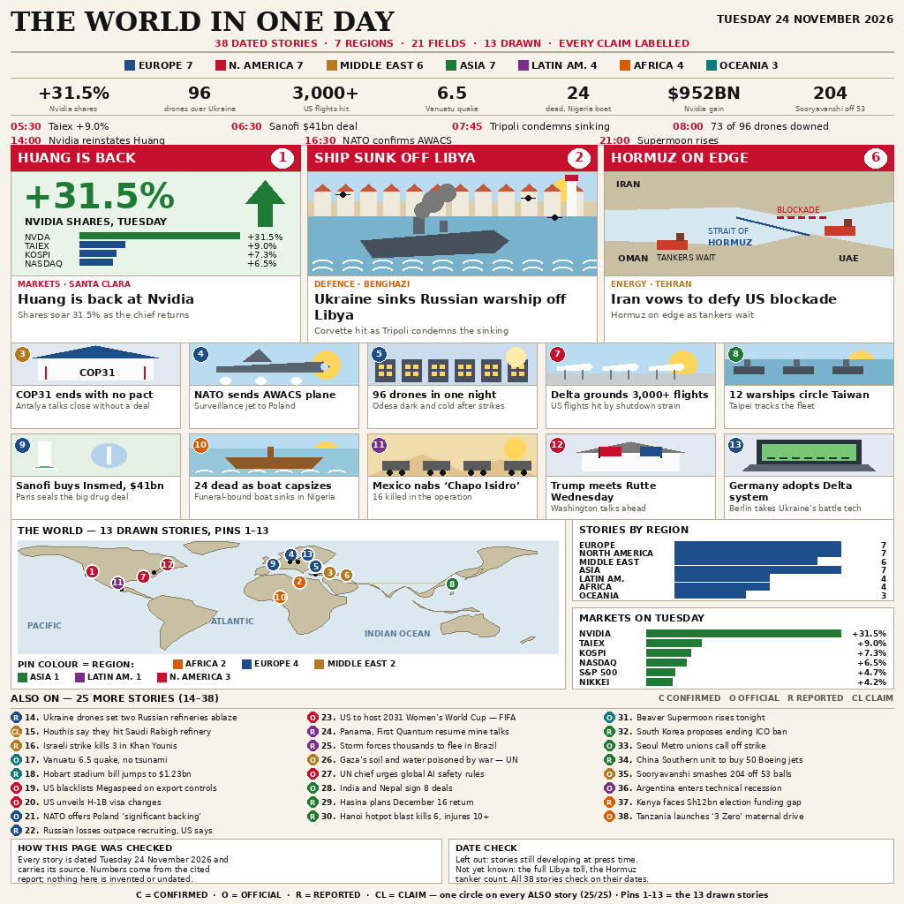

# The World in One Day — Tuesday 24 November 2026 (v5.2)

[](https://make.fun/bounty/news-image-20261124?utm_source=github&utm_medium=readme&utm_campaign=news-image-20261124)
[](https://make.fun/bounty/news-image-20261124?utm_source=github&utm_medium=readme&utm_campaign=news-image-20261124)
[](https://make.fun/bounty/news-image-20261124?utm_source=github&utm_medium=readme&utm_campaign=news-image-20261124)

**Bounty:** [News Image 24 November 2026 — "Sum up 24 November's world news in one image"](https://make.fun/bounty/news-image-20261124) · $100 pot (1st $20, 2nd $12, 3rd $6, 4th–10th $2, 11th–50th $1.20) · Free entry · Entries close 26 Nov 2026 07:00 WIB (00:00 UTC).



## What this is

One 1024×1024 newspaper front page — **38 stories, 7 regions, 21 fields, 13 drawn, every claim labelled** — all dated Tuesday 24 November 2026, drawn entirely in code (Pillow vector shapes, no external images, no network at run time). v5.2 is a full fresh rebuild, not a patch: the two blind A/B rounds before it kept finding the same root cause — 48 stories squeezed into one square made the type cramped and the layout collide — so this version cuts the count to 38 and spends the freed space on bigger type, taller strips, and wider gaps.

## Why 38, and what changed

- **Density down, air up.** 13 drawn stories (3 leads + 10 mids) and 25 ALSO items, instead of 15 + 33. The two weakest mid stories (the Nepal quake, the Bougainville vote) and the eight weakest ALSO stories were dropped outright; nothing was shrunk to fit.
- **Regions merged to 7, none above 7.** East, South-East and South Asia are one Asia now. Europe 7 · N. America 7 · Middle East 6 · Asia 7 · Latin Am. 4 · Africa 4 · Oceania 3.
- **The map got room to breathe.** A solid world map with exactly 13 numbered pins, coloured per region, on their stories' real geography. The Europe cluster is spread with thin leader lines back to each true spot, and the coastal pins (Santa Clara, Benghazi, Antalya, Mexico City) sit on land, not in the sea. Ocean labels are checked against real geography: PACIFIC on the west edge, ATLANTIC in the middle, INDIAN OCEAN below Asia.
- **Claim system, fully executed.** A claim circle (C confirmed, O official, R reported, CL claim) on every single ALSO item (25/25), a legend in the ALSO header, and a definition strip in the footer.
- **Three leads, three devices, one red banner each.** A bright data lead (Nvidia +31.5%, giant number with a mini bar chart), a rich daytime scene (the corvette hit off Benghazi, with town, lighthouse, smoke and drones), and an informative regional map (the Strait of Hormuz, with tankers and a marked blockade line). No night scenes, no dark panels.
- **Charts kept, labels kept whole.** Stories by Region and Markets on Tuesday, both as horizontal bars with full names — "NORTH AMERICA", "OCEANIA" — measured before render, never abbreviated to fit.

## The page, zone by zone

- **Masthead + header claim:** 38 stories · 7 regions · 21 fields · 13 drawn · every claim labelled.
- **Region bar (7 regions, none above 7):** Europe 7 · N. America 7 · Middle East 6 · Asia 7 · Latin Am. 4 · Africa 4 · Oceania 3.
- **IN NUMBERS strip (7, with room to breathe):** +31.5% Nvidia shares · 96 drones over Ukraine · 3,000+ US flights hit · 6.5 Vanuatu quake · 24 dead in the Nigeria boat sinking · $952BN Nvidia gain · 204 Sooryavanshi off 53 balls.
- **THE DAY IN UTC (7 timed items, two airy rows):** 05:30 Taiex +9.0% · 06:30 Sanofi $41bn deal · 07:45 Tripoli condemns sinking · 08:00 73 of 96 drones downed · 14:00 Nvidia reinstates Huang · 16:30 NATO confirms AWACS · 21:00 Supermoon rises.
- **3 pictorial leads, all bright, each with a big red banner word:** HUANG IS BACK (data), SHIP SUNK OFF LIBYA (scene), HORMUZ ON EDGE (map).
- **10 mid stories with bright scene banners** (COP31 hall, NATO AWACS, Odesa's lit windows, Delta's grounded planes, warships off Taiwan, Sanofi's lab, the Nigerian river boat, the Mexico desert convoy, the Trump–Rutte flags, and a laptop running the Delta battle system).
- **Full solid world map** with **13 numbered pins, coloured per region**, Europe's cluster spread with thin leader lines, and a pin-colour count legend on its own two rows underneath: Africa 2 · Asia 1 · Europe 4 · Latin Am. 1 · Middle East 2 · N. America 3.
- **Two chart panels:** Stories by Region (horizontal bars, full region names) and Markets on Tuesday (Nvidia +31.5%, Taiex +9.0%, Kospi +7.3%, Nasdaq +6.5%, S&P 500 +4.7%, Nikkei +4.2%).
- **ALSO ON — 25 more stories (14–38)** in three columns, one short line each, every item carrying a claim circle.
- **HOW THIS PAGE WAS CHECKED box** and a **DATE CHECK footer** (what was left out and what is not yet known, in complete sentences), with the full claim legend as a definition strip.

## The 38 stories

Drawn (13) — leads 1, 2, 6 are the three big pictures, mids 3–5 and 7–13 the small ones:

1. Huang back at Nvidia as shares soar — Santa Clara, US — Reuters / CNN — Markets, Official
2. Ukraine sinks Russian warship off Libya — Benghazi, Libya — Reuters / WSJ — Defence, Official
3. COP31 ends with no pact — Antalya, Turkiye — Reuters — Climate, Official
4. NATO sends AWACS plane — Poland — Reuters — Defence, Official
5. 96 drones in one night; Odesa dark and cold — Ukraine Air Force — Security, Official
6. Iran vows to defy US blockade — Tehran, Iran — Reuters — Energy, Reported
7. Delta grounds 3,000+ US flights — Atlanta, US — Delta — Transport, Official
8. 12 warships circle Taiwan — Taipei, Taiwan — Reuters — Defence, Reported
9. Sanofi buys Insmed for $41 billion — Paris, France — Sanofi / WSJ — Health, Official
10. 24 dead as boat capsizes on way to funeral — Nigeria — AP — Disaster, Reported
11. Mexico nabs 'Chapo Isidro'; 16 killed — Mexico — Reuters — Courts, Official
12. Trump meets Rutte Wednesday — Washington, US — Reuters — Diplomacy, Reported
13. Germany adopts Ukraine's Delta — Berlin, Germany — Reuters — Tech, Official
14. Ukraine drones set two Russian refineries ablaze — Reuters — Defence, Reported
15. Houthis say they hit Saudi Rabigh refinery — Reuters — Energy, Claim
16. Israeli strike kills 3 in Khan Younis — AP — Security, Reported
17. Vanuatu 6.5 quake, no tsunami — AP — Disaster, Official
18. Hobart stadium bill jumps to $1.23 billion — Reuters — Culture, Reported
19. US blacklists Megaspeed over export controls — Reuters — Trade, Official
20. US unveils H-1B visa changes — Reuters — Migration, Official
21. NATO offers Poland 'significant backing' — Reuters — Diplomacy, Official
22. Russian losses outpace recruiting, US says — Reuters — Defence, Reported
23. US to host 2031 Women's World Cup, FIFA says — FIFA — Sport, Official
24. Panama, First Quantum resume Cobre mine talks — Reuters — Trade, Reported
25. Storm forces thousands to flee in Brazil — AP — Disaster, Reported
26. Gaza's soil and water poisoned by war, report finds — UN — Environment, Official
27. UN chief urges global AI safety rules within a year — UN — Tech, Official
28. India and Nepal sign 8 deals — Reuters — Diplomacy, Official
29. Hasina plans December 16 return to Bangladesh — Reuters — Politics, Reported
30. Hanoi hotpot blast kills 6, injures 10+ — AP / Reuters — Crime, Reported
31. Beaver Supermoon rises tonight — Sky at Night — Space, Official
32. South Korea proposes ending nine-year ICO ban — Seoul — Markets, Reported
33. Seoul Metro unions call off strike in wage deal — Yonhap — Labour, Official
34. China Southern unit to buy 50 Boeing 737-8 jets — Reuters — Transport, Reported
35. Sooryavanshi smashes 204 off 53 balls — Doha — The Sports Encounter — Sport, Official
36. Argentina enters technical recession — Buenos Aires Herald — Economy, Official
37. Kenya faces Sh12bn election funding gap — Daily Nation — Politics, Reported
38. Tanzania launches '3 Zero' maternal drive — The Citizen — Health, Official

Dropped from the 48-story set on purpose (weakest of their kind): the Nepal 5.6 quake and the Bougainville nationhood vote (mids), and the Seoul minister reshuffle, Armenia's Karabakh draft, the Cyprus expulsions, the Germany/Denmark bomb threats, the SpaceX lawsuit, the Laos LDC graduation, the Chinese e-truck export push, and the Guangxi builders' Malaysia move (ALSO). Every kept story is dated 24 November 2026.

## Arithmetic (checked by the renderer, which refuses to build otherwise)

Region bar = 38 = header claim = last ALSO number (38). Regions: 7 + 7 + 6 + 7 + 4 + 4 + 3 = 38. Fields: 21 distinct. Drawn pins: 13 (stories 1–13). ALSO items: 25 (stories 14–38). Claim circles: one on every ALSO item, 25 of 25, no ellipsis anywhere. Pin legend counts: 2 + 1 + 4 + 1 + 2 + 3 = 13.

## How it is built

- `draw_news24_v5_2.py` — Python 3 + Pillow, stdlib otherwise. Renders `entry.png` (1024×1024, deterministic) from scratch: layout, typography, all 13 scenes, the solid world map, both charts. No network, no external images. The script is its own layout validator: it fails the build on any overflowing text, any headline or deck needing a third line, any overlapping map pin (16 px minimum after jitter), any ellipsis, any region above 7, any field count other than 21, or any arithmetic mismatch.
- `main.ts` — Node 22, stdlib only. Copies the pre-rendered `entry.png` to the output directory (default `output/`), refusing files outside the 1 byte–1 MiB band, files that are not PNG, and images that are not 1024×1024, and prints the sha256.
- `package.json` — `npm run render` redraws the image; `npm start` runs the entrypoint.

```sh
python3 draw_news24_v5_2.py   # renders entry.png + runs every gate
node main.ts                # copies entry.png -> output/entry.png
```

## Determinism

Two runs of the render produce a byte-identical `entry.png` (verified by sha256 in the build log). The render uses fixed coordinates and no timestamps.

## License

MIT — see `LICENSE`. All maps and drawings are original vector work drawn in code for this entry.
